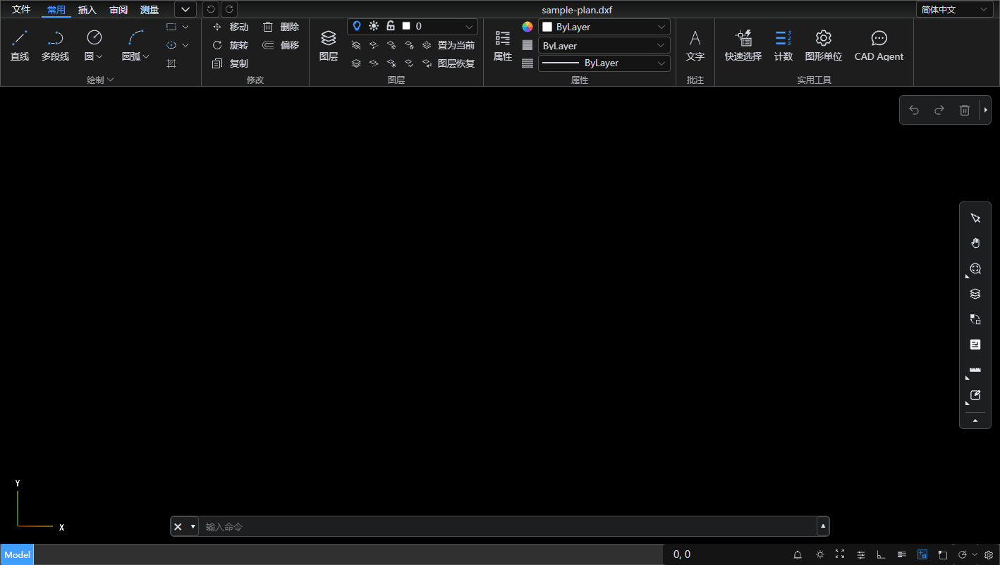

# fnOS CAD 看图

在**飞牛私有云（fnOS）**&#x91CC;直接打开 DWG / DXF 图纸的网页应用。装好之后：

- 🖱️ **在文件管理器里双击 `.dwg` / `.dxf`，直接用本应用打开**——任意位置，不需要预先配置。
  这是**唯一**的入口：1.0.9 起取消了桌面图标
- 🌐 **用浏览器打开**：双击后在新标签页里打开，和普通网页一样（不是嵌在飞牛桌面窗口里）
- 🪟 **整页只有图纸**：没有侧栏、没有顶栏、没有嵌套 iframe —— 应用自带的界面只有出错时的
  一张卡片，其余全是查看器自己的工具栏（图层 / 测量 / 导出）
- 🔓 **装完即用，零配置**：安装包是 root 权限版，服务进程直接读全部存储空间，
  没有"授权目录"这个概念（应用中心里也不显示这个设置项）
- 📐 图层开关、测量距离、缩放平移、导出离线 HTML / PDF / SVG
- 🔒 **图纸不出内网**：解析和渲染全部在你的浏览器里完成，后端只负责把文件读出来
- 🚫 **不依赖 Docker**：作为飞牛原生应用运行，复用系统自带的 Node.js 运行时



_示例图纸 `sample/sample-plan.dxf`（R12 格式）。上面那条 ribbon 与右侧工具栏都是**查看器自带**的，
不是本应用加的 UI。_

|        |                                                                                   |
| ------ | --------------------------------------------------------------------------------- |
| 查看器内核  | [`@mlightcad/cad-viewer`](https://github.com/mlightcad/cad-viewer) **1.7.4**（MIT） |
| DWG 解析 | LibreDWG（WebAssembly，跑在 Web Worker）                                               |
| 应用形态   | 飞牛原生应用 `.fpk`（`install_dep_apps=nodejs_v22`，`run-as: root`）                     |
| 后端     | Node.js 内置模块手写，**零第三方依赖**（连 `node_modules` 都不用装）                                     |

---

## 一、安装到飞牛

### 1. 打包出 `.fpk`

在开发机上：

```bash
npm install
npm test             # 路径工具 + 老式 DXF 兼容层自检
npm run fpk          # 构建前端 → 组装应用包 → 产出 release/fnos-dwg-viewer-1.0.9.fpk
```

脚本会：构建前端 → 把 `dist` 和 `server/*.mjs` 装进 `fnos-package/app/server/` →  
用官方 `fnpack` 打出 `.fpk`（**只有这一个包**，`config/privilege` 里 `run-as: root`；
打包前会断言这一点，防止有人把它改回 `package` → 那种包能装能跑但读不到用户文件）。

> **服务端零依赖**，打包时不会执行 `npm install`，所以整个打包过程很快（约半分钟）。  
> **必须用官方 fnpack 打包**。fnOS 的安装校验要求 `cmd/` 下存在一整套生命周期脚本，
> 而且 `app/` 目录必须被打成 `app.tgz`——这两点用 `tar` 手工打包都做不到，
> 结果就是安装时被拒（提示"应用包不符合系统要求"）。  
> 脚本检测不到 `fnpack` 时会自动下载到 `.tools/`，无需手动准备。  
> fnpack 官方文档：<https://developer.fnnas.com/docs/cli/fnpack/>

> **打包可重复性**：`npm run fpk` 会删掉自己的构建产物（`dist/`、`fnos-package/app/server/`、
> `release/stage-*`）。在装了"安全删除守卫"的环境（如 WorkBuddy 内置终端）里，脚本会**自动
> 用 `CODEBUDDY_SAFE_DELETE_ENABLED=0` 重开自身进程** —— 那个守卫是按**每个工具调用累计
> 50 个文件**来拦删除的，而光 stage 一个目录就有 60+ 文件。不绕开的话症状很隐蔽：第 1 次
> "包其实打好了却非零退出 + stage 残留"，第 2 次**直接构建失败**。  
> **验证方式：连着打 3 次，三次都应退出 0、每次都产出、且没有 `release/stage-*` 残留。**
> 用户自己的终端 / CI 里不受影响（守卫不在场，脚本不会重开进程）。

### 2. 在飞牛上安装

fnOS 后台 → **应用中心 → 手动安装** → 选择 `release/fnos-dwg-viewer-1.0.9.fpk`。

应用中心里的名字就是 **CAD 看图**（桌面不再生成图标，见下面 §3.3）。manifest 里声明了
`install_dep_apps=nodejs_v22`，飞牛会自动确保系统里的 Node.js v22 运行时可用
——**不需要 Docker，也不需要你手动装任何运行环境**，更不需要配置任何目录。

### 3. 打开图纸

#### 3.1 双击打开（唯一入口）

在飞牛的「文件管理」里双击（或右键选「用 CAD 看图打开」）任意位置的 `.dwg` / `.dxf`，
系统会用**浏览器新标签页**打开本应用并载入该图纸：

```
?path=/vol1/1000/售前项目/2026/812图纸A栋.dxf
```

`source` 固定是 `local`。整个应用只做这一件事 —— 拿到这个路径、读出来、交给查看器渲染。

**为什么不需要授权**：本应用声明了 `run-as: root`，服务进程本身就有读全盘的权限；
代码侧也只看**运行期真实 uid**（`process.getuid() === 0`），不看"装的是不是 root 包"
——后者会骗人。副作用请自查：**它对你的 NAS 有完全读权限**，请只在自己的设备上使用。

#### 3.2 手动敲地址打开时

不带 `?path=` 访问（比如你自己在浏览器里输入 `http://飞牛IP:8020/`）会看到一张说明卡片，
告诉你本应用只用来打开文件、怎么触发它。**这是正常的** —— 1.0.9 起应用里没有文件浏览器了，
所以"空手进来"没有任何可看的东西。

> 服务端仍然保留 `/api/list`、`/api/config`、`/api/doctor`、`/api/session`(WebDAV) 这几个接口
> ——界面上不再调用它们，但排障时可以直接用浏览器或 `curl` 访问
> （例如 `http://飞牛IP:8020/api/doctor` 列出每个存储空间能不能读、当前运行账号与访问模式）。
> 想看顶层入口，看 `/api/config` 里的 `sources`。
>
> 1.0.6 及更早版本还有「授权目录」与「按需授权（从飞牛选择文件夹）」两套机制，
> 1.0.7 已随 root 直读的落地整体删除；历史排查笔记见 `docs/history-authorization.md`。

### 4. 用起来

只有一个入口：**在文件管理里双击 `.dwg` / `.dxf`**，浏览器新标签页打开该图纸。

> 双击打开靠应用包 `app/ui/config` 里注册的 `fileTypes: ["dwg", "dxf"]` 入口，  
> 它声明了 `noDisplay: true` 且是唯一的 `.url` 项 —— 1.0.9 起连桌面图标入口
> （`.main`）也删掉了，桌面不再生成「CAD 看图」图标。

打开后**整页就是图纸**：上面那条 ribbon、右侧工具栏、底部命令行都是查看器自带的，
应用自己没有加任何顶栏或侧栏。

### 4.1 双击后提示"打不开"？

应用在把文件交给查看器**之前**会先做一次预检（`/api/probe`），所以提示是明确的：

| 提示 | 原因 | 解决 |
| --- | --- | --- |
| **这个位置读不进去** | 文件存在，但内核拒绝了读取：存储空间未挂载/已卸载、外接盘被拔出、远程挂载断开、只读介质等 | ① 到 **系统设置 → 存储空间管理**确认该存储空间状态正常；② 外接存储 / 远程挂载的话确认设备在线；③ 确认完后点卡片上的「重试」 |
| **文件不存在** | 被移动 / 重命名 / 删除 | 回飞牛的文件管理确认文件还在原处，然后重新双击 |
| **这是一个目录** | 双击的不是图纸文件 | 选 `.dwg` / `.dxf` 文件 |
| **这个位置不在可访问范围内** | 服务被显式设成了应急的 `FNOS_ACCESS_MODE=scoped` 白名单模式（正常安装不会） | 去掉该环境变量并重启应用，即恢复读取全部存储空间 |
| **应用显示"已停用"** | 早期版本启动方式没脱离会话，脚本退出后进程被回收；或改设置后没人重启 | 1.0.4 已修（`nohup + setsid`，PID 由服务自己写，补齐 `config_init/config_callback`）。升级后到应用中心点一次「启动」即可 |

> 错误卡片上只有 **「重试」** 一个按钮（原本还有个「返回图纸库」，随抽屉一起删了）。
> 权限诊断要直接访问 `http://飞牛IP:8020/api/doctor` —— 它会列出每个存储空间能不能读、
> 在哪一级祖先被拒、当前运行账号与访问模式。只想看顶层入口与白名单，
> 看 `/api/config` 里的 `sources` / `allowedRoots`。

> **升级到 1.0.8 后仍然打不开？** 见 `docs/troubleshooting.md`。
> 常见答案是：装完到应用中心**停止再启动**一次（`run-as: root` 只在重新拉起进程时生效）。


### 5. 装不上怎么办

应用中心提示 **"应用包不符合系统要求，无法安装"** 时，按下面顺序查：

| 可能原因 | 排查 / 解决 |
| --- | --- |
| **包不是 fnpack 打的**（最常见） | 用 `tar` 手工打的包缺 `cmd/` 生命周期脚本、`app/` 也没打成 `app.tgz`。删掉重跑 `npm run fpk`，脚本会自动下载 fnpack |
| `manifest` 里的 `os_min_version` 高于当前系统 | 本项目**不声明**这个字段，版本门槛交给 `install_dep_apps` 表达，不会因此被拒 |
| 端口被占用（`checkport=true`） | 应用中心会提示端口冲突。改 `manifest` 的 `service_port`，同时改 `app/ui/config` 里那条 `.open` 入口的 `port` |
| 系统缺少 Node.js 运行时 | `manifest` 声明了 `install_dep_apps=nodejs_v22`，应用中心应会自动装。装完在 **应用中心 → 已安装** 里确认 `nodejs_v22` 存在 |
| 想看确切原因 | SSH 进飞牛，执行 `journalctl -u trim_app_center --since "10 minutes ago" \| tail -80`，或 `cat /var/log/appcenter*.log` |

改完 `manifest` 后记得同步 `scripts/build-fpk.mjs` 里的自检列表（若新增了必需文件）。

---

## 二、用 Docker 跑（备选）

不想打 `.fpk`，或者想在别的 Linux 机器上跑，用容器也行：

```bash
# 改 docker-compose.yml 里的挂载路径，指向你的存储空间
docker compose up -d --build
# 打开 http://飞牛IP:8020
```

这种方式**没有**双击打开（那需要 `.fpk` 装进应用中心才有）。装的是 `.fpk` 时桌面也不会有图标
——那正是 1.0.9 去掉的东西。容器里直接访问 `http://飞牛IP:8020/?path=/data/xxx.dxf` 即可看图纸。

---

## 三、本机跑（开发 / 调试）

```bash
npm install
npm run build
npm start            # http://localhost:8020
```

图纸在 NAS 上、应用跑在 PC 上时，切到 **WebDAV** 模式（任意标准 WebDAV 服务都行）：

1. fnOS 后台 → 设置 → 文件服务 → WebDAV → 启用（HTTP 默认 5005 / HTTPS 默认 5006）
2. 文件管理 → 团队文件 → 目标文件夹右键编辑 → 勾选  
   **"允许通过文件共享协议（SMB、WebDAV、FTP）挂载到其他设备上"**
3. 确认登录账号对该文件夹有读取权限
4. 应用界面切到「WebDAV」，填地址 / 账号 / 密码（地址可以只写 `192.168.1.10:5005`）

开发模式（带热更新）：

```bash
npm run dev          # 前端 5173，自动代理 /api 到 8020
npm start            # 另开终端跑后端
```

排查图纸打不开的问题时，可以在地址后加 `?debug=1`，  
页面会把 `AcApDocManager` 挂到 `window.__AcApDocManager`，方便在控制台里  
查当前文档、图元数量、图纸范围等：

```js
const m = window.__AcApDocManager.tryGetInstance()
m.curDocument.fileName              // 当前图纸
m.context.view.getDrawingExtents()  // 图纸实际包围盒，可用于判断几何是否转换成功
```

`sample/sample-plan.dxf` 是一张自动生成的测试图纸（24 个图元，**故意用 R12 / AC1009 格式**，
方便顺带验证老式 DXF 兼容层），可直接验证整条链路：

正常打开后应看到红色墙体（WALL）、蓝色窗（WINDOW）、绿色门弧（DOOR）、
青色家具圆与矩形（FURNITURE）。

```bash
npm run test:dxf     # 老式 DXF 兼容层的自检，不需要浏览器
```

---

## 四、它是怎么工作的

```
┌──────────── 浏览器 ────────────┐        ┌──── fnOS 上的应用进程（root）────┐
│  Vue3 应用                      │        │  Node（仅内置模块）        │
│   只有一个 CAD 查看器            │  HTTP  │   ├─ /api/probe 预检       │
│   （没有侧栏/顶栏/嵌套 iframe）   │ ─────▶ │   ├─ /api/file 读文件      │
│        DWG 解析 + 渲染都在这     │        │   └─ 托管前端静态资源      │
└────────────────────────────────┘        └───────────┬───────────────┘
                                                      │ 只读
                              全部存储空间 /vol1 /vol2 /vol00 …
```

**为什么需要一个小后端？**

1. 浏览器没法直接读 NAS 的磁盘路径，得有人把文件递出来；
2. 前端与图纸同源，查看器 `fetch` 时没有 CORS 问题；
3. 后端还能做**预检**（`/api/probe`）——先确认文件存在、类型对、读得动，
   再把地址交给查看器，这样出错时给的是可操作的指引而不是查看器抛出的裸 URL。

容器/进程本身非常轻——真正吃性能的 DWG 解析全在用户浏览器里跑。

**几个实现上的坑（都已处理）**

| 坑                                           | 处理方式                                        |
| ------------------------------------------- | ------------------------------------------- |
| 查看器用 `new URL(uri)` 解析地址且不带 base            | 传给它的地址必须是**绝对 URL**                         |
| 查看器按 URL 后缀判断文件类型                           | 下载地址末尾要带真实文件名（`/api/file/xxx.dwg?path=...`） |
| `Write` 模式默认还原图纸里保存的视图，没有 VPORT 表的图纸会缩成一点 | 打开模式用 `Write`，但把 `openViewMode` **显式**写成 `extents` 按图纸范围取景 |
| **ribbon 只显示「测量」，缺「常用 / 插入 / 审阅」**           | 标签是按打开模式过滤的，`Read` 模式下只留 `measurement`。必须 `mode=Write`（详见下节） |
| ~~**图纸库抽屉整个看不见**~~                            | **已不适用（1.0.9 抽屉已删）**，留档：查看器/Element Plus 会把 `body` 设成 `display:flex`，`#app` 宽度塌成 0，被 `overflow:hidden` 裁掉 |
| ~~**抽屉盖住 ribbon 最左边的「文件 / 常用」**~~              | **已不适用（1.0.9 抽屉已删）**，留档：查看器根节点是 `position:fixed;inset:0`，只挪 `.viewer` 无效，要直接覆盖它的 `left` |
| 「正在渲染图纸」遮罩停留很久                             | 打开 `progressiveRendering`，图元转完即撤遮罩                      |
| DWG 解析器是 GPL 的 LibreDWG，查看器刻意不打包            | 显式注册转换器，并把 worker + wasm 部署到 `/assets/`     |
| **老式 DXF（R12/AC1009）打不开、只画出一个单位圆**            | 后端读取时补回缺失的 `100` 子类标记，详见下一节                |
| **装着 root 包却提示"尚未授权"**                            | 包改成 `run-as: root` 了，代码却仍按"授权目录为空 → 全部拦下"处理（1.0.5 的事故）。**判定只看运行期真实 uid**：`process.getuid() === 0` 才代表真有权限，包长什么样不算数 |
| **`/api/list` 顶层是 /vol1、/vol00 这种挂载点**           | 用户不认这些名字 → 顶层条目统一改叫「存储空间 1」「存储空间 00」（`rootLabel()`），点进去才是原样路径。1.0.7 曾改成按飞牛文件管理分类列「我的文件 / 团队文件 / 外接存储…」，1.0.8 撤回：飞牛已经分好了，应用再分一套只是多一层要维护、且跟不上系统变化的映射。**1.0.9 起界面上不再调用这个接口**，仅留作排障入口 |
| **标题栏中文文件名显示成 `%E5%9B%BE…`**                 | 查看器的 `getFileNameFromUri` 取 `pathname` 末段且**不解码**，在 `AcApDocument` 的取值器上套一层解码即可（见下节） |
| ~~「图纸库」悬浮按钮压住顶部菜单栏~~                      | **已不适用（1.0.9 按钮已删）**。留档当时的解法：从左上角挪到左下角后仍不理想（离图面太远），最终改为**运行时测量查看器 canvas 的左上角**，钉在工具栏下方（ribbon 高度会变，写死数值必然出错） |
| **双击后嵌在飞牛桌面窗口里打开（不是浏览器新标签页）**            | 服务还是 `iframe` 型 —— `cmd/fix-open-type` 没跑成。见 §5.1；手工核对：`su - postgres -c "psql -d appcenter -c \"select service_name,type from app_service where app_id=(select id from app where app_name='fnos-dwg-viewer')\""` 应为 `url` |
| **桌面上还留着一个点不开的「CAD 看图」图标**                   | 同理，`trim_sac.entry` / `user_desktop_entry` 没清干净。见 §5.1。也确认 `manifest` 里 `desktop_applaunchname` 的**值是空的**（fnpack 会无条件写出这个键，值空才是对的） |
| **"我的文件"里有的子文件夹能显示、有的不能**                  | 那是旧的"授权目录"模式留下的坑（飞牛给每个应用建独立系统账号，授权只加在目录本身时已有子目录没有 ACL）。1.0.7 起进程是 root，不再经过这层权限，问题消失 |
| **错误提示是"没有读取权限：undefined"**                  | `listLocal` 里 readdir/stat 抛错后没把路径传下去。凡是可能抛 FS 错误的地方都要 `toApiError(err, abs)` |
| **应用莫名变成"已停用"**                             | ① `node index.mjs &` 没脱离会话，脚本退出后进程被回收 → 改 `nohup + setsid + </dev/null`；② PID 取 `$!`（setsid 会 fork，拿到的是壳进程）→ 改由服务自己在 `listen` 后写；③ 缺 `config_callback`，用户改设置后飞牛停掉应用却没人重启 |
| 访问 `AcApDocManager.instance` 直接白屏                | 实例未创建时该 getter 会**抛异常**，只能等查看器初始化完；能不用实例就别用（本项目最终没用） |

### 关于中文文件名（标题栏显示成 `%E5%9B%BE…`）

URL 里不能裸放中文，所以 `/api/file/<文件名>` 的末段必然被 `encodeURIComponent`。
查看器读取文件名的方式是：

```js
getFileNameFromUri(uri) {
  const parts = new URL(uri).pathname.split('/')
  return parts[parts.length - 1] || ''   // ← 不做 decodeURIComponent
}
```

于是标题栏、导出文件名全是百分号编码。它没有"传入显示名"的入口，本项目在  
`src/main.ts` 里给 `AcApDocument` 的 `fileName` / `docTitle` 取值器套了一层解码  
（沿原型链找 getter，解不开就原样返回），**任何时刻读到的都是真实中文名**。

> 不要试图靠监听 `documentActivated` 再改名字：那要抢事件注册顺序，
> 而且首次打开时查看器可能已经把编码名抄进了自己的响应式变量。

### 关于 ribbon 标签（打开模式）

查看器源码里的可见性白名单是：

```js
const visible = tab.id === 'measurement' ? true
              : tab.id === 'review'      ? mode >= AcEdOpenMode.Review
              :                            mode === AcEdOpenMode.Write
```

也就是说，只有 `Write` 才能拿到「常用 / 插入」。本项目用  
`mode=Write` + `openViewMode=Extents`，两者配合：菜单齐全，同时取景正确。

> 查看器的文件菜单里**没有"保存"**，所以 `Write` 不会把改动写回 NAS。

### 关于老式 DXF（R12 / AC1009）

`@mlightcad/data-model` 的 `AcDbEntity.dxfInFields` 是这样写的：只有在**下一个组码是 `100`**
时才提前返回，否则就把后面的组码一路吞到对象结束。而 R12 及更早的 DXF **没有 `100`
子类标记**（子类标记从 R13 才引入），于是 `LINE` 的 `10/20/11/21`、`CIRCLE` 的 `40`
全部被基类当"未知码"吃掉——表现为图纸里所有图元都退化成默认值（顶点全 0、半径 1），
**打开后只能看到一个单位圆**。

这是内核的缺陷，不是图纸的问题（用 AutoCAD 导出的任何 R12 DXF 都会命中）。
所以本项目在 `server/dxf-legacy.mjs` 里做了一层兼容：按 DXF 规范把缺失的 `100` 标记
补回去，**不改动任何数值**。

判定条件很严格——整份文件里**一个 `100` 都没有**才动手，因此：

- 现代 DXF（R2000 / AC1015 及以上）完全不受影响，原样透传
- 二进制 DXF、超过 64 MB 的文件直接跳过
- 全程按 `latin1` 逐字节处理，不会碰坏任何代码页（GBK / Big5 / UTF-8 都安全）

---

## 五、关于"能不能直接调 fnOS 的文件管理应用"

结论：**不建议，也没必要**。

1. **fnOS 文件管理没有公开 API。** 底层是 WebSocket 私有协议（`user.login` / `file.ls` /
   `file.mkdir` / `file.rm` …），登录要先交换 RSA 公钥、再用 HMAC 给请求签名，还带一套
   `reqid` 规则。社区项目都是抓包逆向出来的，官方无文档，随版本升级随时可能失效。
2. **就算调通了也只能拿到"文件列表"。** 文件内容最终还是得变成字节流喂给浏览器里的解析器。
3. **应用直读磁盘更彻底。** 装在 fnOS 本机后就是直接读文件系统，比调用文件管理应用更底层、
   更稳、更快，也不依赖任何未公开接口。

那"双击打开"怎么办？—— 用**官方支持的方式**：入口声明 `fileTypes`，
飞牛会主动把路径以 `?path=` 传给应用。这是文档里写明的机制，稳定可靠。

那权限怎么办？—— **本应用直接以 root 运行**（`config/privilege` 里 `run-as: root`），
进程本身就能读全部存储空间，不需要任何"授权"步骤。飞牛把这个能力开放给本地安装的
应用（上架官方应用中心另有限制），这也是"装完什么都不用配"的唯一实现方式。

> 1.0.5 曾接入飞牛官方网页 SDK `@trimjs/web-app` 的 `pickUserFile` /
> `authorizeUserFile`，在应用里做"按需授权"；1.0.6 起又发现只要进程能拿到 root
> 就完全不需要这套东西，1.0.7 把它整体删掉了 —— 少一条交互路径，也少一类
> "按钮点了没反应（宿主桥接握手超时）"的故障。

### 5.1 ★★ 为什么装完还要改数据库（`cmd/fix-open-type`）

**应用中心对第三方包只会建 `iframe` 型服务** —— 而 `iframe` 型就是"嵌在飞牛桌面窗口里"。
1.0.9 要的是**用浏览器新标签页打开**，这就得让服务变成 `url` 型。

这不是配置问题，是**应用中心的硬编码**。证据（真机实测）：

- `/usr/trim/bin/trim_app_center` 二进制里，`iframe` 只作为**常量**出现两次，
  和 `hidden` / `kernel` / `docker` 并排；**整个二进制里根本没有 `url` 类型常量**。
  ⇒ `app/ui/config` 里写 `"type": "url"` 是**没用的**，写库的不读它。
- 但**飞牛前端**（`/usr/trim/www/assets/index-*.js`）是按这个字段分流的：

  ```js
  E1 = function(e){ return e.URL = `url`, e.Iframe = `iframe`, e }({})
  type: e.iframe ? `iframe` : `url`
  // 启动器：
  if (e.url && !e.iframe) {
    n?.params && (e.url = ee(e.url, n?.params))
    window.open(e.url, `_blank`, `noopener`)   // ← 浏览器新标签页打开
    return null                                 // ← 不占用桌面窗口
  }
  isDisplay: !e.hiddenDesktopIcon
  ```

  ⇒ **服务行 `type === 'url'` ⇒ 浏览器打开；`'iframe'` ⇒ 嵌进桌面窗口。**

所以 `cmd/fix-open-type` 在**安装 / 改设置 / 升级**之后各跑一次，同时改两个库：

| 库 | 表 | 改什么 |
| --- | --- | --- |
| `appcenter` | `app_service` | `type = 'url'` |
| `appcenter` | `app_shortcut` / `app_open` | 删（桌面图标关联；`app_open` 每应用**只有一行**） |
| `trim_sac` | `entry` | `open_type = 'url'`；删掉 `.main` 那条 |
| `trim_sac` | `user_desktop_entry` | 标 `is_deleted = true` |

**两个库都要改，只改一个不生效** —— 这是踩过的坑：删了 `appcenter.app_shortcut` 之后
桌面图标**还在**，因为前端桌面列表读的是 `appcgi.sac.entry.v1.getUserDesktop`，
数据源是 `trim_sac.user_desktop_entry` + `entry`。

> 脚本是**幂等**的，且**任何一步失败都不让安装失败**（记警告 + `exit 0`）。
> 系统版本变了导致表结构不认，最坏结果也只是"回到 iframe 型入口"，不会把应用装坏。
>
> ⚠️ 另一个坑：`app_service.app_id` 是 **bigint 外键 → `app.id`**，不是应用名；
> 拿名字去比会报 `invalid input syntax for type bigint`。

---

## 六、已知限制

以下大多来自 `cad-viewer` 1.7.4 内核自身的边界（最后一行为内核缺陷，本项目已绕过）：

| 项目        | 情况                                    |
| --------- | ------------------------------------- |
| DWG 兼容性   | 依赖 LibreDWG，个别图纸可能打不开                 |
| 天正图纸      | 天正自定义对象无公开接口，需先用天正导出为 **T3** 格式       |
| 表格实体（DWG） | 不支持；用直线/多段线画的表格正常                     |
| 外部参照 XRef | 不支持，不会显示                              |
| 图纸空间      | 仅模型空间                                 |
| DXF       | 支持 R12 ~ 最新（部分特性渐进支持），支持 GBK 编码，中文不乱码 |
| DXF（R12）  | 内核原本读不出图元几何，已由后端兼容层补全（见"四、它是怎么工作的"）    |

---

## 七、目录结构

```
fnos-dwg-viewer/
├── src/                        前端（Vue3）
│   ├── main.ts                 注册 DWG 解析器 + 修正标题栏中文名 + 挂载
│   ├── App.vue                 全屏查看器（**没有侧栏/顶栏/嵌套 iframe**）；处理 ?path= 入参
│   │                           + 出错卡片 + 不带 ?path= 时的说明卡片
│   ├── api.ts                  后端接口封装（只剩 probe 与 fileUrl 两个调用）
│   └── styles.css              全局样式（含"#app 塌宽"那个坑的说明）
├── server/
│   ├── index.mjs               后端：本机磁盘 + WebDAV；root 直读、/api/doctor 自检
│   │                           （/api/list 界面已不再调用，留作排障入口）
│   ├── path-utils.mjs          路径纯函数：环境变量切分 / 白名单 / 兜底还原
│   └── dxf-legacy.mjs          老式 DXF（R12）兼容层：补回 100 子类标记
├── fnos-package/               .fpk 应用包源码
│   ├── manifest                应用元数据（install_dep_apps=nodejs_v22、disable_authorization_path=true）
│   │                           ★ 1.0.9 起**不声明** desktop_applaunchname（取消桌面图标）
│   ├── config/privilege        ★ run-as: root（打包时会被断言，改回 package 会直接失败）
│   ├── config/resource         资源声明（空对象）
│   ├── cmd/main                生命周期脚本（启动 / 停止 / 状态；nohup+setsid 脱离会话）
│   ├── cmd/install_init        ★ 安装前检查
│   ├── cmd/install_callback    ★ 安装后：建目录、写日志、启动服务、修正入口类型
│   ├── cmd/uninstall_init      ★ 卸载前：先停服务
│   ├── cmd/uninstall_callback  ★ 卸载后：清理 PID / 日志
│   ├── cmd/upgrade_init        ★ 升级前：停服务并记住运行状态
│   ├── cmd/upgrade_callback    ★ 升级后：按原状态重新拉起 + 修正入口类型
│   ├── cmd/config_init         ★ 改设置前：只记日志
│   ├── cmd/config_callback     ★ 改设置后：重启服务 + 修正入口类型
│   ├── cmd/fix-open-type       ★ 1.0.9 自加：把打开方式改成 url 型、清桌面图标（见 §5.1）
│   ├── wizard/install          安装说明
│   ├── app/ui/config           ★ 只有「用 CAD 看图打开」一条（无桌面图标，type=url）
│   ├── app/ui/images/          入口图标
│   └── app/server/             ← 打包时生成（server/*.mjs + dist，无 node_modules）
├── scripts/
│   ├── copy-workers.mjs        部署解析 worker + wasm
│   ├── make-icons.py           生成飞牛图标（纯标准库）
│   ├── make-sample-dxf.py      生成测试图纸
│   ├── pack-src.py             打源码 zip（开发环境没有 zip 命令时用）
│   ├── test-dxf-legacy.mjs     老式 DXF 兼容层自检
│   ├── test-path-utils.mjs     路径工具自检（多目录分隔符 / 编码还原 / 上溯兜底）
│   ├── e2e-local.mjs           应急 scoped 模式接口校验（需要先按 scoped 起服务）
│   ├── e2e-allmode.mjs         root 直读 + 顶层存储空间列表校验（主力用例）
│   ├── smoke-browser.mjs       真实 Chrome 冒烟测试（截图到 docs/）
│   └── build-fpk.mjs           打包 .fpk（缺 fnpack 时自动下载到 .tools/）
├── docs/troubleshooting.md     常见问题与排查（1.0.9）
├── docs/history-authorization.md  1.0.6 及更早的"授权目录"排查笔记（历史存档）
├── .tools/fnpack               打包器缓存（自动下载，已 gitignore）
├── Dockerfile / docker-compose.yml   备选：容器方式
└── sample/sample-plan.dxf      测试用图纸（故意用 R12 格式，顺带覆盖兼容层）
```

运行期数据目录（`TRIM_PKGVAR`，本机开发时是 `var/`）：

| 文件 | 说明 |
| --- | --- |
| `webdav.json` | WebDAV 连接信息（0600），重启后不用重填 |
| `app.pid` | 服务自己写的 PID（`FNOS_PID_FILE`），应用中心据此判断是否在运行 |
| `app.log` | 标准输出日志 |

> **标 ★ 的 `cmd/*` 八个脚本是 fnOS 安装校验的硬性要求**。  
> 少了任何一个，应用中心都可能拒绝安装（提示"应用包不符合系统要求"）。
> `fnpack` 打包前会逐个检查，本项目在 `scripts/build-fpk.mjs` 里也做了一遍同样的自检。
> `config_callback` 尤其关键：没有它，用户在设置里点保存、飞牛把应用停掉之后，
> 没有人负责再把它拉起来，表现就是"应用变成已停用"。

**打好的 `.fpk` 内部结构**（`app/` 会被 fnpack 打成 `app.tgz`，不是目录）：

```
manifest            ← fnpack 会重排并追加 checksum
ICON.PNG
ICON_256.PNG
app.tgz             ← 内含 server/{index.mjs,dxf-legacy.mjs,path-utils.mjs,dist/}、ui/{config,images/}
cmd/                8 个生命周期脚本
config/{privilege,resource}
wizard/install
```

## 八、环境变量

| 变量                                     | 默认     | 说明                                |
| -------------------------------------- | ------ | --------------------------------- |
| `PORT`                                 | `8020` | 服务端口（需与 manifest.service_port 一致） |
| `LOCAL_ROOT`                           | 见下     | 「本机存储」的单一浏览根目录（Docker / 非飞牛环境用） |
| `ALLOW_PREFIXES`                       | 空      | **只在应急模式（`FNOS_ACCESS_MODE=scoped`）下生效**：允许读取的绝对路径前缀，逗号 / 分号 / 冒号都能做分隔符 |
| `FNOS_VOL_ROOTS`                       | 自动探测   | 存储空间根目录列表（默认扫 `/` 下的 `/volN`）。Docker 挂整盘、或在 Windows 上开发调试时显式指定 |
| `FNOS_ACCESS_MODE`                     | 空      | **应急开关**：设为 `scoped` 时退回"只认 `ALLOW_PREFIXES` 白名单"的老行为。正常安装不需要它（默认就是 root 直读） |
| `FNOS_URL` / `FNOS_USER` / `FNOS_PASS` | 空      | WebDAV 默认连接，省去每次手填                |
| `FNOS_INSECURE_TLS`                    | 空      | 设为 `1` 时忽略自签名证书校验                 |
| `FNOS_PID_FILE`                        | 空      | 指定后，服务会在 `listen` 成功时把自己的 pid 写进去（`cmd/main` 靠它判断运行状态） |
| `TRIM_PKGVAR`                          | 空      | 飞牛给的运行期数据目录；WebDAV 连接信息（`webdav.json`）存在这里 |

**权限模型**（`server/index.mjs`）：

```
UNRESTRICTED = (FNOS_ACCESS_MODE !== 'scoped')      // 1.0.7 起默认即全盘直读
isAllowed(abs) = UNRESTRICTED ? true : (abs 在 LOCAL_ROOT / 存储空间 / ALLOW_PREFIXES 之内)
```

进程身份只用于**诊断与提示**（`process.getuid() === 0` → 打印 root 直读；否则提示
"当前账号读得到的只有自己有权限的部分"），**不参与放行决策** —— 后者曾经反过来写，
于是出现过「包是 root 版、代码却按空白的授权列表拦路径」这种荒唐结果。

顶层浏览根的算法（`browseSources()`）：就是**各个存储空间的挂载点**，
`/vol1` → 「存储空间 1」、`/vol00` → 「存储空间 00」（`rootLabel()` 把挂载点换成
飞牛界面里的叫法），**不排序之外的加工**，点进去就是那个卷的原始目录：

```
browseSources() = allowedRoots() 映射成 { label: rootLabel(p), path: p }
allowedRoots()  = LOCAL_ROOT ∪ detectStorageRoots() ∪ ALLOW_PREFIXES
detectStorageRoots()  = FNOS_VOL_ROOTS，或扫 `/` 下形如 /volN 的挂载点（字典序）
```

> 1.0.7 曾在应用里替用户分「我的文件 / 团队文件 / 外接存储 / 远程挂载 / 应用文件」
> （`detectLocalSources()` + 读 `/proc/mounts` + sysfs 判可移除设备），1.0.8 已整体撤掉：
> 飞牛自己的文件管理已经分好了，应用里再分一套只是多一层要维护、且跟不上系统变化的映射
> —— 卷怎么切、哪个算外接盘是系统的事。

> ⚠️ 历史坑（仍是 `path-utils.mjs` 里 `splitEnvList` 的由来）：飞牛把多个授权目录用
> **冒号**拼接传下来（`/vol1/a:/vol1/b`），而 Windows 盘符自带冒号（`C:\data`）。
> 这个差异被 `npm run test:path` 锁住——改这里务必先跑测试。

---

## 九、自检脚本

| 命令 | 作用 |
| --- | --- |
| `npm run test:path` | 路径工具单元测试（11 个用例）：多目录分隔符、编码还原、上溯兜底 |
| `npm run test:dxf` | 老式 DXF 子类标记兼容层自检（7 项） |
| `npm run e2e:all` | **主力校验**（26 项）：root 直读（存储空间之外的目录照样能列、能读）+ 顶层列出各存储空间（名字与顺序）+ `/api/grant` 已下线。**需要对一个按下方夹具方式起的服务跑** |
| `npm run e2e` | 应急 scoped 模式校验（35 项 / Windows 上 34 项）：多目录解析、虚拟根、probe、编码还原、越权拦截、`/api/doctor`、WebDAV 地址容错 |
| `npm run smoke -- "<url>"` | 真实 Chrome 打开页面，检查"打不开"卡片、真实文件名、**没有任何应用自带的界面**（无抽屉/无悬浮按钮/查看器铺满视口），并截图到 `docs/` |

> `npm run e2e` 里有一条 **Windows 上会自动跳过**：「冒号拼接串兜底还原」。
> 原因是 `recoverCandidates` 按 `:` 朴素切段，而 Windows 盘符自带冒号，
> 本地复现不了（飞牛是 Linux，`/vol1/a:/vol1/b` 切出来正好两段）。
> 脚本会打印一行「跳过…」，**不会假装通过**。

`e2e:all` 要在**能复现飞牛存储布局**的环境下跑。飞牛上直接跑就行（有真的 `/volN`）；
开发机上只有一个开关 `FNOS_VOL_ROOTS` 要设 —— `scripts/e2e-allmode.mjs` 会自己建夹具（幂等），
所以先起服务、再跑脚本：

```bash
FNOS_VOL_ROOTS="C:/tmp/fnos-sim2/vol1:C:/tmp/fnos-sim2/vol2:C:/tmp/fnos-sim2/vol00:C:/tmp/fnos-sim2/vol3" \
PORT=8129 TRIM_PKGVAR=C:/tmp/fnos-sim2/var node server/index.mjs &

E2E_BASE=http://127.0.0.1:8129 npm run e2e:all
```

夹具里故意放了四个卷，形态各不相同：普通多用户卷（`vol1` 有 `1000/` 和 `@team`/`@appshare`/`@appdata`）、
只有一个用户目录的卷（`vol2`）、两位数列卷（`vol00`，飞牛上就是外接盘）、
以及**一个只有普通共享文件夹的卷**（`vol3`）—— 它必须照样以「存储空间 3」出现，不能凭空消失。
另外夹具会在存储空间之外再建一棵 `C:/tmp/fnos-outside/外挂图纸/o.dxf`，
用来验证"白名单/存储空间之外的路径也能列、能读"（这正是 root 直读的意义）。

浏览器冒烟测试还认两个环境变量：`SHOT_NAME`（截图文件名，
默认 `screenshot-1.0.9.png`）与
`SMOKE_EVAL="..."`（截图前在页面里执行一段脚本，用来展开某个面板；**返回值会打印出来**，
方便确认面板真的渲染了）。

同一份脚本用两次就能覆盖两种入口：

```bash
# 双击打开：看图纸 + 断言"整页没有应用自带界面"
npm run smoke -- "http://127.0.0.1:8124/?path=<编码后的图纸绝对路径>&debug=1"

# 不带 path：断言给的是说明卡片而不是空白页
npm run smoke -- "http://127.0.0.1:8124/"
```

> **排查线上问题的两个只读接口**（浏览器直接打开即可）：  
> `/api/config`（访问模式 / 顶层 `sources`（各存储空间）/ 运行账号 / 原始环境变量），  
> `/api/doctor`（逐个存储空间体检：能不能读、在哪一级祖先被拒；root 正常时不该出现任何修复建议）。
>
> 1.0.6 及以前还有 `/api/grant`（按需授权的登记表）。1.0.7 起该接口已删除，访问会返回 404 ——
> 如果哪个脚本还在调它，把那段删掉即可。历史原因见 [`docs/history-authorization.md`](docs/history-authorization.md)。

---

MIT License。查看器内核版权归 MLightCAD；LibreDWG 解析器为 GPL-3.0，  
仅以独立 worker 形式部署，不进入主包。
